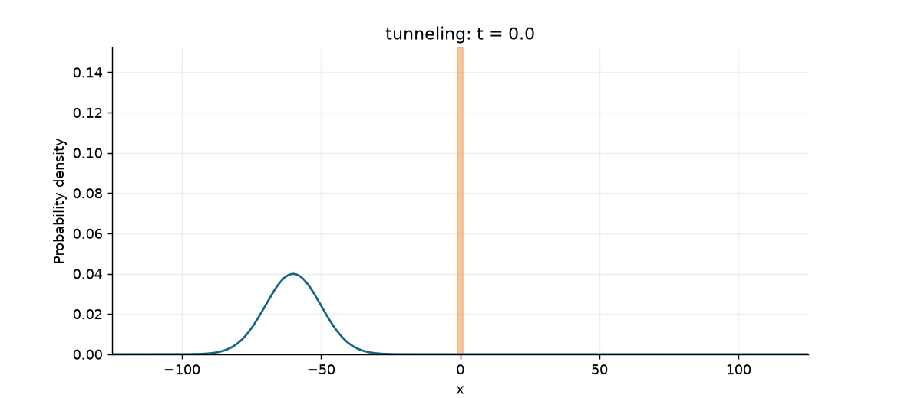
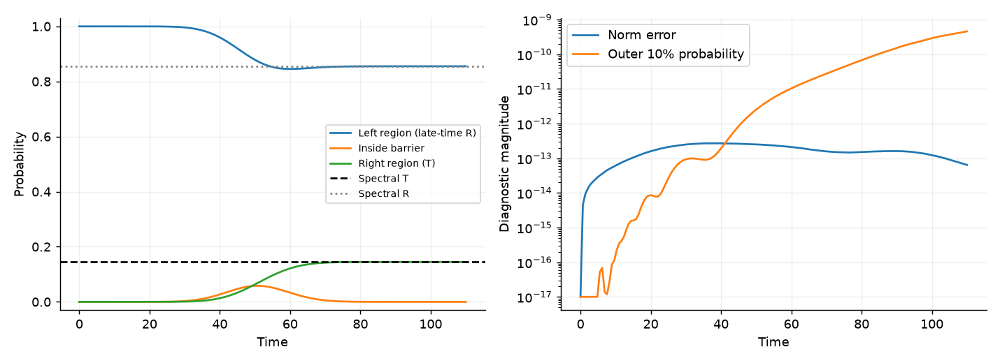
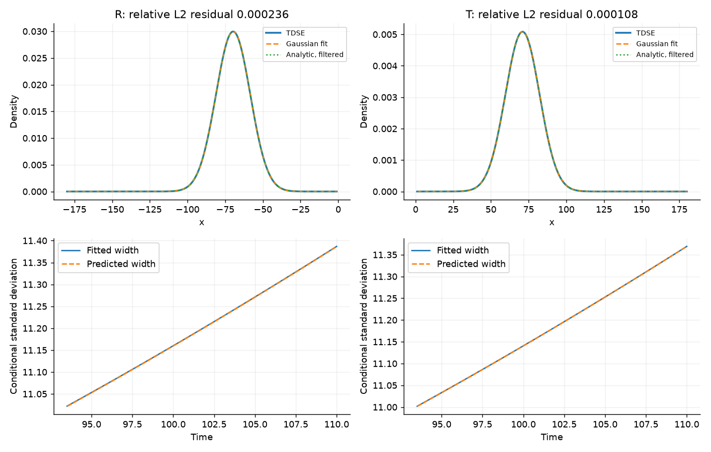
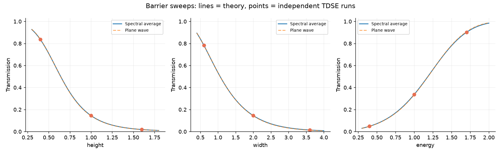

# Gaussian wave-packet scattering

**A computational quantum mechanics project connecting stationary scattering
theory to a time-resolved numerical experiment.**

Launch a Gaussian packet at a finite square barrier, watch tunneling and
reflection, and test the simulation against continuum scattering amplitudes.
The project goes beyond visualization: it measures transmission, fits outgoing
packets, checks phase-delay and spreading predictions, and studies numerical
convergence with two independent solvers.



## Main questions

- Does right-region probability settle to the spectral prediction
  $T=\int_0^\infty |f(k)|^2|t(k)|^2\,dk$?
- When are the reflected and transmitted packets approximately Gaussian?
- How do phase curvature and momentum filtering change their centers and widths?
- Which discrepancies come from numerical resolution, and which come from the
  narrow-band approximation?

## Quick start

Requires Python 3.10 or later. From this repository directory:

```sh
python -m venv .venv
# Linux/macOS:
source .venv/bin/activate
# Windows PowerShell instead:
# .venv\Scripts\Activate.ps1
python -m pip install -e ".[dev]"
python -m pytest -q
python scripts/run_experiments.py --suite demo --animate
```

Generate all figures and validation data:

```sh
python scripts/run_experiments.py --suite all --animate
python scripts/check_results.py
```

For faster individual studies, use `--suite sweeps` or `--suite validation`.
Outputs default to `figures/`; use `--out another_directory` to preserve the
included reference results. No notebook, GPU, FFmpeg, or external data is needed.
Animation uses Pillow. The complete suite takes longer than a demo because it
runs 25 TDSE experiments; runtime depends on your machine.

## Included results

Default units are $\hbar=m=1$, with $U_0=1$, $L=2$, $x_0=-60$ and
$\sigma_x=10$. The spatial step is 0.1 and time step 0.01.

| Case | Carrier energy | TDSE transmission | Spectral prediction | Absolute error |
|---|---:|---:|---:|---:|
| Tunneling | 0.7 | 0.144855 | 0.145062 | 0.000207 |
| Above barrier | 1.5 | 0.778803 | 0.779879 | 0.001076 |

Norm drift is below $5\times10^{-13}$ in these demonstrations. All four
outgoing density fits have relative L2 residual below 0.1%. These are measured
results for the included cases, not guarantees for arbitrary parameters.
See [the results report](docs/results.md) for convergence and fit details.





## Read the physics

1. [Analytic theory](docs/theory.md): normalized packet, matching equations,
   complex amplitudes, parity connection, spectral probabilities, phase delays,
   spreading and momentum filtering.
2. [Numerical methods](docs/numerics.md): split-operator FFT, Crank–Nicolson,
   grid construction, boundary diagnostics and convergence studies.
3. [Measured results](docs/results.md): what the experiments establish and their limits.

The theory keeps the original initial position $x_0$ and the quadratic barrier
phase explicitly. Gaussian behavior is tested rather than assumed. Near sharp
resonances or for broad momentum distributions, it can fail.

## Reuse the code

```python
import numpy as np
from qscatter import Config, simulate, packet_transmission

config = Config(height=1.0, width=2.0, energy=0.7)
run = simulate(config)
left, inside, right = run["probabilities"][-1]
expected = packet_transmission(np.sqrt(2*config.energy), config.sigma,
                               config.height, config.width)
print(right, expected)
```

Use `Config(method="cn")` for the independent finite-difference solver.
Barrier edges must align with grid-cell faces; invalid combinations raise a
clear error. Changing energy may require changing the final time and box size.

## Repository map

```text
src/qscatter/
  theory.py          # stable complex amplitudes, spectral T, Gaussian predictions
  simulation.py      # grid, initial state, FFT and CN propagation
  analysis.py        # Gaussian envelope fitting and residuals
scripts/
  run_experiments.py # demos, GIFs, sweeps, convergence and machine-readable outputs
tests/
  test_physics.py    # analytic limits and numerical physics checks
docs/                # derivations, methods and results
figures/             # generated PNGs, GIFs, CSVs and JSON summaries
.github/workflows/   # automated test workflow
```

## Interpretation and limitations

The left-region probability initially contains the incident packet; only its
late-time plateau is reflection. FFT boundaries are periodic, so simulations
must stop before returning waves contaminate the result. There is no absorbing
layer and no renormalization. Norm conservation does not prove convergence.
The density fits verify Gaussian envelopes, not the full complex phase.

The spectral formula describes an asymptotic incoming state. A Gaussian
initialized at finite distance is an approximation to that state; the supplied
packet starts nearly six widths from the barrier edge. Positive-momentum
conditioning is recorded explicitly. No exact Gaussian claim is made for all
barrier parameters or all times.

## Suggested research extensions

The strongest next experiment is a bandwidth sweep: identify where Gaussian
fits fail as momentum filtering becomes strong, then compare the full complex
wavefunction with spectral quadrature. Other directions include above-barrier
resonance phase delays, probability-current arrival times, and double-barrier
resonant tunneling. The current code already supplies the reusable components.

## Reproducibility and sharing

The JSON files record configuration and diagnostic values, and
`figures/environment.json` records the generation environment. `requirements-lock.txt`
captures that environment; `pyproject.toml` gives portable minimum dependencies.
The included GitHub Actions workflow runs the test suite on Python 3.10 and 3.12.
It has not been run on GitHub as part of this local build.

Code and original documentation use the MIT license. Reference links appear
in the theory document.
